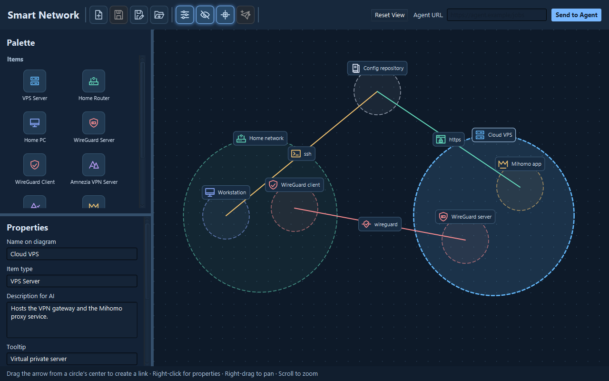

# Smart Network

A JavaFX editor for drawing network diagrams on Windows.



## Build and run

On Windows, double-click `run-win.bat`. It builds the application with Maven if the JAR is missing.

To build and run manually, open PowerShell in the project root:

```powershell
$env:JAVA_HOME = 'C:\Development\Java\jdk-24.0.2'
$javafx = 'C:\Development\Java\javafx-sdk-25.0.1'
mvn package
& "$env:JAVA_HOME\bin\java.exe" --enable-native-access=javafx.graphics --module-path "$javafx\lib" --add-modules javafx.controls -jar target/smart-network-1.0.0.jar
```

The build paths are defined in `pom.xml`. Override them with the Maven options `-Djdk.home=...` and `-Djavafx.home=...`.

## Edit a diagram

- Drag an item from the palette onto an empty part of the canvas or into another circle. Nested items move with their parent. When a circle grows, neighboring circles move outward.
- To create a link, hover over a circle and drag the arrow from its center to another circle. New links use the `UNKNOWN` type. Choose a protocol in the link's properties. Press Esc to cancel the drag.
- Left-click to select an item and left-drag to move it. Right-click an item to open its context menu for properties or deletion. Right-drag to pan the canvas and scroll to zoom.
- Press F2 or double-click an item to rename it. Press Enter or click away to apply the new name.
- To reconnect a selected link, drag one of its endpoint handles onto another circle.
- Alignment guides appear when the center of the circle you are dragging is within five screen pixels of another center on either axis. Release the mouse button to snap to that coordinate. The **Snap** toolbar button toggles this mode.
- The selected item's properties appear below the palette. Use the **Properties** toolbar button to show or hide this panel. The **Hide secrets** button masks IP addresses, usernames, and passwords as `********`. Turn it off to edit those fields. The editor omits these values from the JSON it sends to the agent.

## Project files

The first toolbar group contains **New Project**, **Save**, **Save As**, and **Load From**. After you load a project or save it using **Save As**, **Save** writes changes to the current file. The editor prompts you to save unsaved changes before creating or loading another project.

Project files use the `.json-sn` extension and contain formatted JSON with coordinates, nesting, properties, and links. The editor writes IP addresses, usernames, and passwords to the project file in plain text. The masking toggle affects only how those values appear in the editor.

## Connect an AI agent

Enter the full URL of the agent's job endpoint in the address field or set `SMART_NETWORK_AGENT_URL`. Click the blue send button to submit the diagram as an HTTP POST with `Content-Type: application/json; charset=UTF-8`. A 2xx response confirms that the agent accepted the project. The connected agent handles network deployment.

The request body contains `schemaVersion` (1), `nodes`, and `links`. Each node or link has `id`, `type`, `typeName`, `customName`, `tooltip`, `descriptionForAi`, and `iconPath`. A node also has `parentId` (its parent's UUID or `null`), `x`, and `y` in diagram coordinates. A link also has `sourceId` and `targetId` with its endpoints' UUIDs. The `iconPath` refers to an SVG resource inside the JAR.
